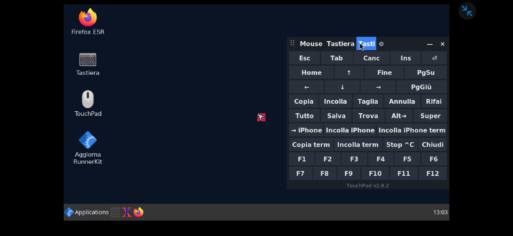
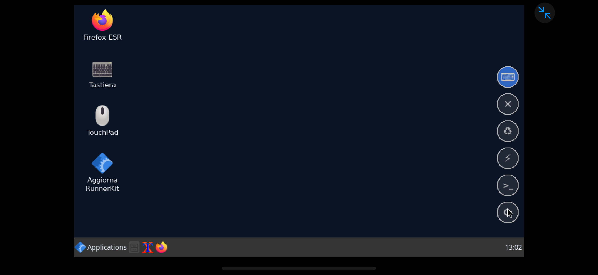

# FMlab - RunnerKit 📱🐧

[🇮🇹 Italiano](README.md) · 🇬🇧 English

**The all-in-one kit for using Linux on iPhone with [LinuxRunner](https://github.com/mxhm11cr/LinuxRunner).**
Touch control, keyboard, disk cleaning, performance, backups and one-tap updates for LinuxRunner's
Debian desktop. Install with one command, update with one tap.

> The tools' interface is in Italian (the author's language). The on-screen keyboard follows Linux's
> language: Italian layout when Linux is Italian, US layout otherwise.

<p align="center">
  
  
</p>

## Install

In Debian's terminal (inside LinuxRunner):

```sh
apt install -y curl && curl -fsSL https://raw.githubusercontent.com/cipherdesk007-max/mia/main/install.sh | sh
```

Only needed **once**. After that it updates itself with no commands: tap the **⟳** bubble (it turns
**orange** when a new version is out, checked every 6 hours), the **Aggiorna RunnerKit** desktop icon, or `rk aggiorna`.

Tested on **iPhone 15 Pro Max, iOS 27.2, LinuxRunner 1.1.0 (build 900), Debian 13**, LinuxRunner
desktop (Openbox) at 960×540 with the Metal GPU enabled.

## The tools

| Tool | What it does |
|---|---|
| **TouchPad** | Trackpad with a cursor, right click, Italian/US keyboard, special keys, and a bubble dock on the screen edge |
| **Centro** (Center) | System (live RAM/CPU/disk gauges), disk cleaning with one tap or by category, performance profiles, processes |
| **UnaVolta** ("once") | Repeated taps on an icon open the program only once; if it's already open, its window is raised |
| **Pulizia** (cleaning) | Safe disk cleaning, reports, optional weekly auto-clean |
| **RunnerBoost** | Speed diagnosis, Metal GPU check (% of draws on Metal), repeatable benchmark with history, profiles |
| **Terminale** | Status bar pinned at the top, colored prompt, single `rk` command, clipboard shared with iPhone |
| **Collaudo · Backup · Italiano** | On-device self-test report, backup/restore to the Files app, Italian locale |

Type `rk` in a terminal for all commands, `rk versioni` for installed versions.

### TouchPad bubble dock

| Bubble | Tap |
|---|---|
| ⌨ | Reopen TouchPad where it was |
| ✕ | Tap a window to close it; tap ✕ again to force-close a frozen one. Desktop, panel and TouchPad are protected |
| ♻ | Open the Center on **Cleaning** |
| ⚡ | Open the Center on **System** |
| >_ | Open a terminal |
| ⟳ | Update RunnerKit; if already up to date it just says so. **Orange** = update available |

### How LinuxRunner 1.1.0 uses the GPU (read from its source code)

Programs launched from the desktop draw OpenGL on the iPhone's GPU through a library LinuxRunner loads
into their processes (`LR_GUI_GPU_ACTIVE=mesa-metal-resident`, device `/dev/linuxrunner-gpu`). Browsers stay
on software rendering by LinuxRunner's choice. `runnerboost --gpu` reports FPS and the share of draws done
on Metal. First result on a 15 Pro Max: **glxgears at 68.7 FPS** at 960×540.

### Useful commands

| Command | What it does |
|---|---|
| `rk centro` | Open the Center window |
| `rk collaudo` | Test everything on the real phone and save a report to Shared (visible in the Files app) |
| `rk backup` / `rk ripristina` | Back up / restore settings, desktop, scripts and the package list (keeps 5, safety copy before restore) |
| `pulizia --sicura` | Clean only what regenerates itself: apt cache, app caches, trash, old logs, temp files older than 3 days |
| `runnerboost` | Diagnosis with recommendations ordered by impact |
| `rk copia TEXT` · `cmd \| rk copia` · `rk incolla` | iPhone clipboard via LinuxRunner's `/dev/clipboard` |
| `rk italiano` / `rk italiano off` | Italian locale for Debian, programs (via UnaVolta), terminal and Firefox |

## Quality

Every change is tested by **GitHub Actions** on a virtual display: key/click engine, TouchPad and Center
windows, bubbles, single instance, clipboard, UnaVolta, cleaning, backup/restore, locale, terminal bar in a
pseudo-terminal, GPU check. Test screenshots update themselves in
[`screenshots/ultima-versione/`](screenshots/ultima-versione/). History: [CHANGELOG.md](CHANGELOG.md).

## Credits

- **[LinuxRunner](https://github.com/mxhm11cr/LinuxRunner)** by Leminos (@mxhm11cr): ARM64 Linux on iPhone and
  iPad without jailbreak, with Metal GPU and JIT. RunnerKit exists because LinuxRunner exists.
- **[iSH](https://github.com/ish-app/ish)**, the foundation LinuxRunner is built on.
- Debian, Mesa, Openbox, Tk and every open-source project the desktop relies on.

FMlab - RunnerKit is an independent FMlab project, not affiliated with LinuxRunner.
