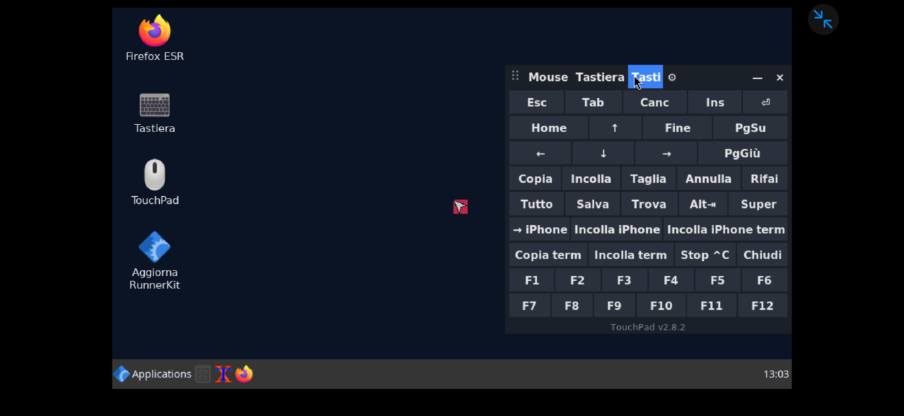
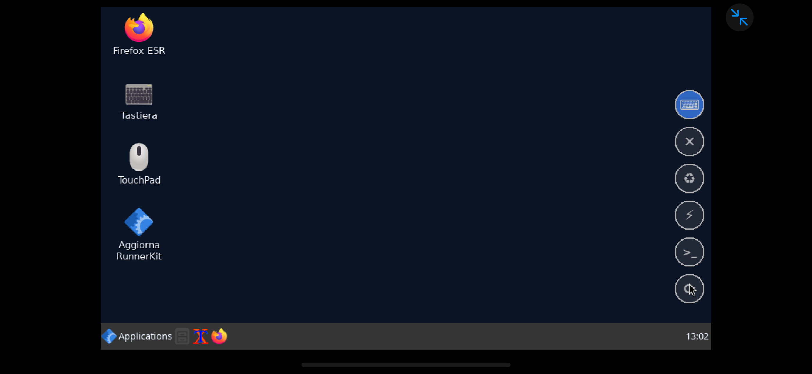
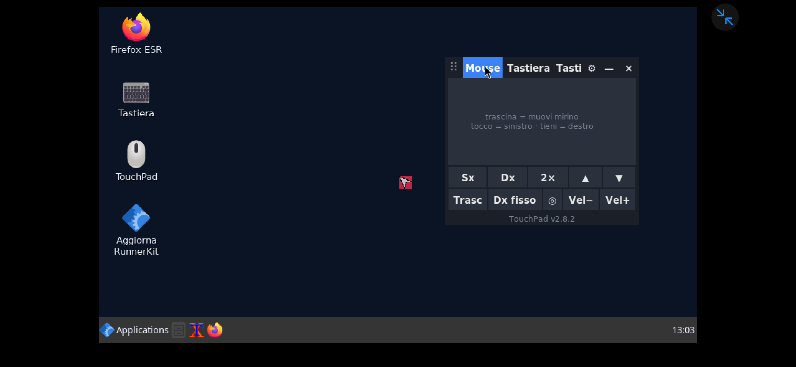
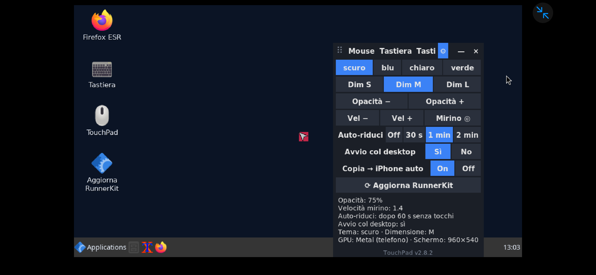

# FMlab - RunnerKit 📱🐧

🇮🇹 Italiano · [🇬🇧 English](README.en.md)

**FMlab - RunnerKit** è il kit tutto-in-uno per usare Linux sull'iPhone con [LinuxRunner](https://github.com/mxhm11cr/LinuxRunner).
Tocco, tastiera, pulizia, velocità, backup e aggiornamenti per il desktop Debian di LinuxRunner.
Si installa con un comando e poi si aggiorna con un tocco.

<p align="center">
  
  
</p>

## Installazione

Nel terminale di Debian (in LinuxRunner):

```sh
apt install -y curl && curl -fsSL https://raw.githubusercontent.com/cipherdesk007-max/FMlab---RunnerKit/stabile/install.sh | sh
```

Serve **solo la prima volta**. Poi si aggiorna da solo, senza comandi:
- pallino **⟳** di TouchPad, che **diventa arancione** quando c'è una novità (controllo ogni 6 ore);
- icona **Aggiorna RunnerKit** sul desktop;
- `rk aggiorna` nel terminale.

Gli aggiornamenti arrivano dal ramo **`stabile`**: ci finisce solo una versione che ha superato tutti i test
automatici. Se la rete cade a metà, RunnerKit resta com'era (scarica tutto, controlla, poi installa).
Per togliere tutto e rimettere il sistema come prima: `rk disinstalla`.

Provato su **iPhone 15 Pro Max, iOS 27.2, LinuxRunner 1.1.0 (build 900), Debian 13**, con desktop
LinuxRunner (Openbox) a 960×540 e GPU Metal attiva.

## Gli strumenti

| Strumento | Cosa fa |
|---|---|
| [**TouchPad**](#touchpad) | Mouse con mirino, tasto destro, tastiera italiana, tasti speciali e colonna di pallini sul lato |
| [**Centro**](#centro-runnerkit) | Finestra con sistema (RAM, CPU, disco dal vivo), pulizia del disco a scelta e processi |
| [**UnaVolta**](#unavolta) | Tocchi ripetuti su un'icona aprono il programma una volta sola |
| [**Pulizia**](#pulizia) | Pulizia sicura del disco, report, automatica una volta a settimana |
| [**RunnerBoost**](#runnerboost) | Diagnosi della velocità, prova della GPU Metal, test ripetibile con storico, profili |
| [**Terminale**](#terminale) | Barra di stato, prompt a colori, comando unico `rk`, appunti condivisi con l'iPhone |
| [**Collaudo · Backup · Italiano**](#collaudo-backup-italiano-appunti) | Report di prova, salvataggio dei file, Linux in italiano |

Scrivi `rk` in un terminale per vedere tutti i comandi, e `rk versioni` per sapere cosa è installato.

## TouchPad

<p align="center">
  
  
  
</p>

| Pagina | Cosa fa |
|---|---|
| **Mouse** | Trascini sul riquadro per muovere il mirino rosso: tocco = clic sinistro, pressione lunga = clic destro. Tasti Sx, Dx, doppio clic, scroll, Trascina, Dx fisso, centra il mirino, velocità |
| **Tastiera** | Segue la lingua di Linux: italiana (à è ì ò ù) se Linux è in italiano, altrimenti USA. ⇧ e ⇪, Ctrl e Alt per il tasto successivo, ⌫ e frecce che si ripetono tenendo premuto. Nei simboli (`?123`) anche **Esc, Tab, ← →** per il terminale. I tasti funzione hanno un colore a parte, Invio è evidenziato e ogni tasto si illumina quando lo tocchi |
| **Tasti** | Esc, Tab, frecce, Home/Fine, PgSu/PgGiù, F1–F12, Copia/Incolla (anche da terminale), Alt+Tab, Alt+F4, **→ iPhone** e **Incolla iPhone** |
| **⚙** | Tema, dimensione, opacità, velocità, Auto-riduci, avvio col desktop, copia automatica verso l'iPhone. In fondo **⟳ Aggiorna**, **ℹ Info** (riepilogo in un quadro a parte) e **✕ Esci** (chiude TouchPad del tutto) |

**Colonna di pallini.** Con **×**, o da solo dopo 1 minuto che non lo usi, TouchPad diventa una colonna sul lato:

| Pallino | Tocco |
|---|---|
| ⌨ | Riapre TouchPad dov'era, sulla stessa pagina |
| ✕ | Tocchi una finestra e si chiude. Se è bloccata, ✕ di nuovo la forza. Desktop, barra e TouchPad sono protetti |
| ♻ | Apre il Centro sulla **Pulizia** |
| ⚡ | Apre il Centro sul **Sistema** |
| >_ | Apre il terminale |
| ⟳ | Aggiorna RunnerKit. Se è già aggiornato lo dice soltanto. **Arancione** = c'è una novità |

Trascinando un pallino si sposta tutta la colonna, che si aggancia al lato più vicino. TouchPad parte con
il desktop (e a ogni "Open Desktop") direttamente come colonna di pallini sul lato, si apre una volta sola e resta sempre sopra le altre finestre.

## Centro RunnerKit

Si apre dall'icona **RunnerKit Centro**, dai pallini ♻ e ⚡, oppure con `rk centro`.

| Scheda | Cosa mostra |
|---|---|
| **Sistema** | Indicatori circolari per RAM, processore e disco (verde, giallo, rosso), grafico degli ultimi 3 minuti, swap, carico, da quanto è acceso, processi, GPU e JIT |
| **Pulizia** | **⚡ Pulizia rapida** con un tocco, oppure ogni categoria con la sua dimensione e una barra: scegli e premi **Pulisci selezionati**. I pacchetti inutili sono "avanzati" e non vengono scelti di default. Pulizia settimanale on/off e report completo |
| **Prestazioni** | Profili Veloce / Bilanciato / Normale con un tocco, trasparenza on/off, test di velocità, prova GPU, diagnosi e consigli, pulizia rapida |
| **Processi** | I programmi che usano più memoria e CPU, aggiornati ogni 3 s, con **Chiudi**, poi **Forza** se non rispondono. I processi del sistema sono protetti |

Legge tutto direttamente dal sistema, senza lanciare programmi per misurare, e aggiorna solo la scheda visibile.

## UnaVolta

Sul telefono un tocco "sporco" vale due o tre clic. UnaVolta sta davanti a icone, menu e barra:
più tocchi entro 4 secondi producono **un solo avvio**. Se il programma è già aperto, anche se lento a comparire
come Firefox, UnaVolta **porta davanti la sua finestra** invece di aprirne un'altra.
Terminali, gestori di file ed editor di testo invece si aprono sempre, perché lì una seconda finestra serve.
`unavolta --log` mostra cosa è successo, `unavolta --ripristina` lo toglie.

## Pulizia

Non tocca **mai** i file personali (Desktop, documenti, Shared, progetti).
Foto, video, l'aggiornamento di iOS scaricato e le altre app non sono raggiungibili da Linux: iOS chiude ogni app
nella sua cartella (lo dice anche la documentazione di LinuxRunner). Il report spiega dove liberarli sul telefono.

| Comando | Cosa fa |
|---|---|
| `pulizia` | Report: disco, RAM, cosa si può cancellare, pacchetti inutili e più grandi, cartelle e file più grandi. Lo salva in Shared, quindi lo vedi dall'app **File** |
| `pulizia --sicura` | Cancella solo ciò che si ricrea da solo: cache di apt e dei programmi chiusi (quella di Firefox aperto resta), cestino, log vecchi, file temporanei con più di 3 giorni (mai quelli dei programmi in funzione), dump di crash |
| `pulizia --sicura --solo apt,cache` | Pulisce solo le categorie indicate |
| (anche in `--sicura`) | Sessioni vecchie del desktop di LinuxRunner (l'app ne crea una a ogni avvio e non le cancella) e report di RunnerKit con più di 30 giorni |
| `pulizia --auto-on` / `--auto-off` | Pulizia automatica all'avvio del desktop, al massimo una volta a settimana |

## RunnerBoost

| Comando | Cosa fa |
|---|---|
| `runnerboost` | Diagnosi: JIT, GPU Metal, risoluzione, RAM, disco, programmi all'avvio, con i **consigli in ordine di effetto** |
| `runnerboost --gpu` | Prova la GPU: fotogrammi al secondo e **% di disegni fatti su Metal** (dalle statistiche di LinuxRunner) |
| `runnerboost --gpu-stats` | Per ogni programma: FPS, disegni su Metal e in software |
| `runnerboost --test "etichetta"` | Test ripetibile (Python, avvio programmi, compressione, sha256, ordinamento), con confronto e storico |
| `runnerboost --riposo` (`rk riposo`) | **Consumo a riposo**: quanto lavora il processore quando non fai niente e quali programmi ne sono la causa. È ciò che scalda il telefono e consuma batteria |
| `runnerboost --profilo veloce \| bilanciato \| normale` | Meno animazioni e un Firefox più leggero (30 fotogrammi al secondo, cache in RAM invece che sulla memoria flash, niente funzioni superflue); normale rimette tutto com'era |

**Come usa la GPU LinuxRunner 1.1.0**, letto dal suo codice: i programmi aperti dal desktop disegnano l'OpenGL
sul chip grafico dell'iPhone tramite una libreria che LinuxRunner carica nei processi
(`LR_GUI_GPU_ACTIVE=mesa-metal-resident`, dispositivo `/dev/linuxrunner-gpu`). I browser restano in software
per scelta di LinuxRunner. Primo risultato su 15 Pro Max: **glxgears a 68,7 FPS** a 960×540 con Metal.

**Velocità senza sciupare il telefono.** Dal codice e dalla documentazione di LinuxRunner (`docs/PERFORMANCE.md`,
`kernel/resource.c`):
- Linux non può cambiare le priorità (`nice` non è supportato): tutti i processi valgono uguale. Quindi
  l'unico modo per avere più velocità e meno calore è **far lavorare meno quello che gira in sottofondo**.
- Lo schermo è disegnato dal processore: con la trasparenza accesa ogni aggiornamento viene ricomposto
  (la prova GPU scende da ~68 a ~33 FPS). Per questo **TouchPad spegne la trasparenza quando è ridotto a
  pallini** e la riaccende solo se lo riapri non opaco.
- Il JIT secondo i loro test rende Python ~1,7 volte più veloce nei calcoli lunghi, ma rallenta l'avvio dei
  programmi brevi: utile solo per lavori pesanti.
- Il telefono quasi pieno rallenta tutto l'iPhone: la diagnosi lo segnala per primo.
- iOS non passa a Linux la temperatura: il calore si controlla dal lavoro, con `rk riposo`.

## Terminale

- **Barra di stato fissa** in cima (RAM, disco, GPU, JIT) mentre i comandi scorrono sotto; si spegne con `rk fisso off`
- Prompt a colori: utente, cartella, ramo git, ✘ se l'ultimo comando fallisce, ⏱ se dura più di 3 s
- Storia dei comandi lunga, senza doppioni, con data e ora
- Comando unico **`rk`**: `rk centro`, `rk info`, `rk top`, `rk gpu`, `rk boost`, `rk pulizia`, `rk pulisci`,
  `rk log`, `rk collaudo`, `rk backup`, `rk ripristina`, `rk italiano`, `rk copia`, `rk incolla`, `rk aggiorna`, `rk versioni`, `rk disinstalla`

## Collaudo, Backup, Italiano, Appunti

| Comando | Cosa fa |
|---|---|
| `rk collaudo` | Prova ogni strumento sul telefono vero (GPU, XTEST, TouchPad, UnaVolta con 4 tocchi, icone, pulizia, spazio, backup) e salva un report in Shared |
| `rk backup` / `rk ripristina` | Impostazioni, desktop, script, configurazione SSH ed elenco dei pacchetti in `Shared/RunnerKit-backup` (ultimi 5). Le chiavi SSH private restano fuori, perché la cartella dell'app File è visibile ad altre app (per includerle: `RKB_CHIAVI=1 rk backup`). Prima di ripristinare fa una copia di sicurezza |
| `rk italiano` / `rk italiano off` | Lingua italiana per Debian, per i programmi aperti da icone e menu (tramite UnaVolta), per il terminale e per Firefox |
| `rk copia TESTO` · `comando \| rk copia` · `rk incolla` | Appunti condivisi con l'iPhone, tramite il dispositivo `/dev/clipboard` di LinuxRunner |
| `rk disinstalla [--tutto]` | Toglie RunnerKit e annulla le sue modifiche (icone, avvio automatico, terminale, UnaVolta, profilo, lingua). Con `--tutto` toglie anche le impostazioni; i backup restano |

## Qualità e verifiche

- Ogni modifica viene provata da **GitHub Actions** su uno schermo virtuale: motore di tasti e clic, finestre
  di TouchPad e del Centro, pallini, istanza unica, appunti, UnaVolta, Pulizia, backup e ripristino,
  italiano, barra del terminale in un pseudo-terminale, prova GPU.
- **Prova completa dell'installatore** come sul telefono: installazione, "già aggiornato", un file rovinato o una
  pagina di accesso Wi-Fi al posto della versione (non deve cambiare niente), disinstallazione.
- Solo se tutto passa, la versione viene copiata sul ramo **`stabile`**, da cui installano e si aggiornano i telefoni.
- Gli screenshot dei test si aggiornano da soli in [`screenshots/ultima-versione/`](screenshots/ultima-versione/);
  le foto dal telefono sono in [`screenshots/telefono/`](screenshots/telefono/).
- Storico delle versioni: [CHANGELOG.md](CHANGELOG.md) · versione del kit: [VERSIONE](VERSIONE).

## Ringraziamenti

- **[LinuxRunner](https://github.com/mxhm11cr/LinuxRunner)** di Leminos (@mxhm11cr): l'app che porta Linux
  ARM64 su iPhone e iPad senza jailbreak, con GPU Metal e JIT. RunnerKit esiste perché esiste LinuxRunner.
- **[iSH](https://github.com/ish-app/ish)**: la base su cui è costruito LinuxRunner.
- Debian, Mesa, Openbox, Tk e tutti i progetti open source su cui poggia il desktop.

FMlab - RunnerKit è un progetto indipendente di FMlab e non è affiliato a LinuxRunner.
Licenza: [MIT](LICENSE).

## Struttura

```
install.sh        installatore/aggiornatore     VERSIONE     versione del kit
touchpad/         TouchPad                      strumenti/   Centro, Collaudo, Backup, Italiano, Aggiorna, Disinstalla
unavolta/         UnaVolta                      pulizia/     Pulizia
runnerboost/      RunnerBoost                   terminale/   Terminale
tests/            test automatici               screenshots/ foto dal telefono e dai test
```
