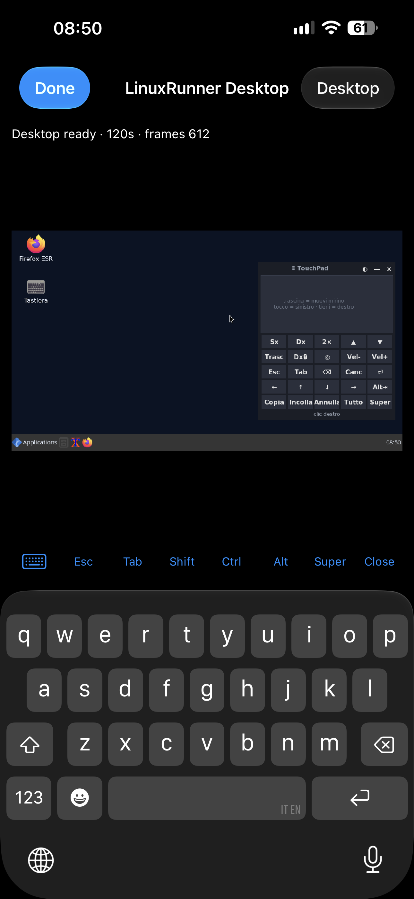

# RunnerKit 📱🐧

**Il kit per usare Linux sull'iPhone con LinuxRunner.**
Tutto quello che serve installare sul Debian di LinuxRunner sta qui, con un comando solo.

| Strumento | Versione | A cosa serve |
|---|---|---|
| [TouchPad](#touchpad) | 2.6.0 | Mouse, tasto destro e tastiera italiana touch, fluttuanti sul desktop |
| [UnaVolta](#unavolta) | 1.1.0 | Tocchi ripetuti su un'icona aprono il programma una volta sola; se è già aperto lo porta davanti |
| [Pulizia](#pulizia) | 1.0.0 | Agente di pulizia del disco: report di cosa occupa spazio, pulizia sicura, automatica a settimana |
| [RunnerBoost](#runnerboost) | 1.2.0 | Diagnosi della velocità, test ripetibile con storico, profili veloce / bilanciato / normale |
| [Terminale](#terminale) | 1.1.0 | Prompt a colori con ramo git, esito e durata dei comandi, statistiche, monitor dal vivo, scorciatoie |
| *prossimi strumenti* | | |

> Pensato per i limiti di LinuxRunner: niente kernel né compositing, CPU emulata.
> Per questo gli strumenti evitano processi esterni e grafica pesante.

## TouchPad

Pulsantiera fluttuante e semitrasparente con **mini touchpad**, **tasto destro** e
**tastiera italiana completa**, pensata per usare il desktop Linux col dito.



### Installare o aggiornare

Nel terminale **del desktop** (xterm):

```sh
apt install -y curl && curl -fsSL https://raw.githubusercontent.com/cipherdesk007-max/mia/main/install.sh | sh
```

Poi aprilo dall'**icona sul desktop**, da **Applications → TouchPad** oppure scrivendo `touchpad` in qualsiasi terminale (anche il Terminal dell'app: si apre comunque sul desktop). Per aggiornare rilancia lo stesso comando.

### Come si usa

| Pagina | Cosa fa |
|---|---|
| **Mouse** | Trascina sul riquadro = muovi il mirino rosso · tocco = clic sinistro · tieni premuto = clic destro. Tasti Sx, Dx, 2×, scroll ▲▼, Trasc (segna partenza, sposta, ripremi), Dx fisso (ogni tocco sullo schermo = destro), ◎ centra il mirino. |
| **Tastiera** | QWERTY italiana con à è ì ò ù, `?123` per i simboli, ⇧ una volta / ⇪ bloccato, Ctrl e Alt valgono per il tasto successivo. ⌫ e frecce si ripetono tenendo premuto. |
| **Tasti** | Esc, Tab, frecce, Home/Fine, PgSu/PgGiù, F1–F12, Copia/Incolla (anche versione terminale), Annulla, Salva, Trova, Alt+Tab, Alt+F4. |
| **⚙** | Tema, dimensione S/M/L, opacità, velocità del mirino. |

Barra in alto: **⠿** sposta la finestra · **—** riduce · **×** chiude.
La finestra resta sempre dentro lo schermo.

**Avvio automatico:** dopo l'installazione TouchPad si apre da solo ogni volta che avvii il desktop.
Si spegne/riaccende da **⚙ → Avvio col desktop**.

**Colonna di pallini:** con **—**, o da solo quando non lo usi per 1 minuto (Auto-riduci, regolabile in ⚙),
TouchPad diventa una colonna di pallini rotondi sul lato dello schermo:

| Pallino | Tocco |
|---|---|
| ⌨ | Riapre TouchPad dov'era, sulla stessa pagina |
| ✕ | Chiudi finestra: tocca la finestra e si chiude. Se è bloccata, ✕ di nuovo entro 15 s la forza |
| ♻ | Pulizia sicura in sottofondo, poi ti dice quanto ha liberato |
| ⚡ | Apre RunnerBoost (diagnosi) in un terminale |
| >_ | Apre il terminale |

Trascinando un pallino si sposta tutta la colonna, che si aggancia al lato più vicino.
Se rilanci `touchpad` mentre è già aperto, riappare quello che c'è.

**Tutto in uno:** l'installatore mette TouchPad insieme a tutti gli altri strumenti di RunnerKit.

**Trasparenza:** serve il *compositing*: TouchPad avvia `xcompmgr` da solo.
Su LinuxRunner funziona (provato al 45%, vedi `screenshots/v2.2-impostazioni-opacita-45.png`).
Se in **⚙** leggi "non disponibile", usa Auto-riduci.

## UnaVolta

Sul telefono un tocco "sporco" vale due o tre clic e apre lo stesso programma più volte.
UnaVolta si mette davanti a tutti i lanciatori (icone del desktop, menu Applications, barra):

- tocchi ripetuti sulla stessa icona **entro 4 secondi** → **un solo avvio**;
- programma **già aperto** → porta davanti la sua finestra invece di aprirne un'altra.

Si installa insieme a RunnerKit con lo stesso comando. Altri comandi:

```sh
unavolta --ripristina     # toglie UnaVolta da icone e menu
unavolta --applica        # lo rimette (anche dopo aver installato nuovi programmi)
echo xterm >> ~/.config/unavolta/escludi   # un programma che vuoi poter aprire più volte
```

Dopo `--applica` / `--ripristina` riavvia il desktop (Stop Desktop → Open Desktop).

## Pulizia

Agente di pulizia del disco. **Non tocca mai i file personali** (Desktop, documenti, Shared, progetti).

| Comando | Cosa fa |
|---|---|
| `pulizia` | **Report**: disco, RAM, processi pesanti, cosa si può cancellare, pacchetti inutili e più grandi, cartelle e file più grandi. Lo salva in `Shared`, quindi lo vedi nell'app **File** dell'iPhone (In questo iPhone → LinuxRunner → Shared) e puoi mandarlo |
| `pulizia --prova` | Mostra cosa cancellerebbe la pulizia sicura, senza cancellare |
| `pulizia --sicura` | Cancella solo ciò che si ricrea da solo: cache di apt, cache dei programmi, cestino, log vecchi, temporanei con più di 3 giorni, dump di crash |
| `pulizia --auto-on` / `--auto-off` | Pulizia sicura automatica all'avvio del desktop, al massimo una volta a settimana |

Tutto il resto (pacchetti grandi, `apt autoremove`, file enormi) lo decidi tu guardando il report.

## RunnerBoost

Far rendere al massimo LinuxRunner senza stressare il telefono (iOS rallenta da solo se si scalda:
il telefono non si rompe, ma i numeri peggiorano).

| Comando | Cosa fa |
|---|---|
| `runnerboost` | Diagnosi: JIT, GPU o rendering software, compositing, RAM, disco, programmi all'avvio. Chiude con i **consigli in ordine di effetto** |
| `runnerboost --test "etichetta"` | Test ripetibile (calcolo Python, avvio programmi, compressione, sha256, ordinamento; 3 giri, mediana). Confronta col test precedente |
| `runnerboost --storico` | Tutti i test fatti |
| `runnerboost --gpu` | Prova la GPU: stato reale (Metal o software), renderer OpenGL e fotogrammi al secondo con glxgears. Da lanciare dal terminale del desktop |
| `runnerboost --profilo veloce` | Niente trasparenza, niente animazioni GTK, Firefox più leggero |
| `runnerboost --profilo bilanciato` | Come veloce ma tiene la trasparenza |
| `runnerboost --profilo normale` | Rimette tutto com'era |
| `runnerboost --gpu-stats` | Per ogni programma: FPS, disegni su Metal e in software, % sulla GPU |
| `runnerboost --report` | Diagnosi + storico in un file nella cartella Shared, da mandare |

**Come usa la GPU LinuxRunner 1.1.0** (letto dal suo codice): i programmi aperti dal desktop
disegnano l'OpenGL sul chip grafico dell'iPhone tramite una libreria che LinuxRunner carica nei
processi (`LR_GUI_GPU_ACTIVE=mesa-metal-resident`, dispositivo `/dev/linuxrunner-gpu`).
I browser restano sempre in software per scelta di LinuxRunner. RunnerBoost, Terminale e TouchPad
leggono questi valori reali.

Le modifiche più grosse sono nell'app LinuxRunner, non in Linux: **aggiornare alla 1.1.0 (build 900)**,
**Graphics → Metal**, e (sperimentale) **JIT con StikDebug**. La diagnosi te lo segnala.

Metodo: un `--test` prima, una modifica alla volta, un `--test` dopo. Differenze sotto il 5% sono rumore.

## Terminale

Attivato dall'installatore (si spegne con `rkterminale --off`). Scritto in bash puro che legge `/proc`:
non lancia programmi a ogni prompt, quindi non rallenta.

- **Schermata iniziale**: RAM e disco con barre colorate, da quanto è acceso, carico, processi, stato JIT
- **Prompt**: utente (rosso se root), cartella, ramo git, ✘ e codice se l'ultimo comando fallisce, ⏱ durata se supera 3 s
- **Storia comandi** lunga, senza doppioni, con data e ora; completamento automatico
- `rk` elenco comandi · `rkinfo` statistiche · `rktop` monitor dal vivo
- `aiphone FILE` copia nella cartella dell'app File · `dalliphone` apre quella cartella
- `aggiorna`, `installa`, `cerca`, `rimuovi`, `estrai`, `mkcd`, `spazio`, `memoria`, `rkaggiorna`

### Versioni e test

- Storico: [CHANGELOG.md](CHANGELOG.md) · versione attuale nel file `touchpad/touchpad.py` (`__version__`).
- Ogni aggiornamento viene provato in automatico da GitHub Actions (scheda **Actions**):
  motore tasti/clic (`tests/test_x11.py`) e finestra completa con screenshot
  di ogni pagina (`tests/test_gui.py`, scaricabili come artifact "screenshots").
- Test manuale sul telefono: `xev -event button &`, porta il mirino sulla finestra bianca,
  premi **Dx** → deve comparire `button 3`.

### Struttura

```
install.sh            installatore/aggiornatore
touchpad/touchpad.py  il programma
tests/                test automatici
screenshots/          screenshot dal telefono (e ci/ dai test)
```
